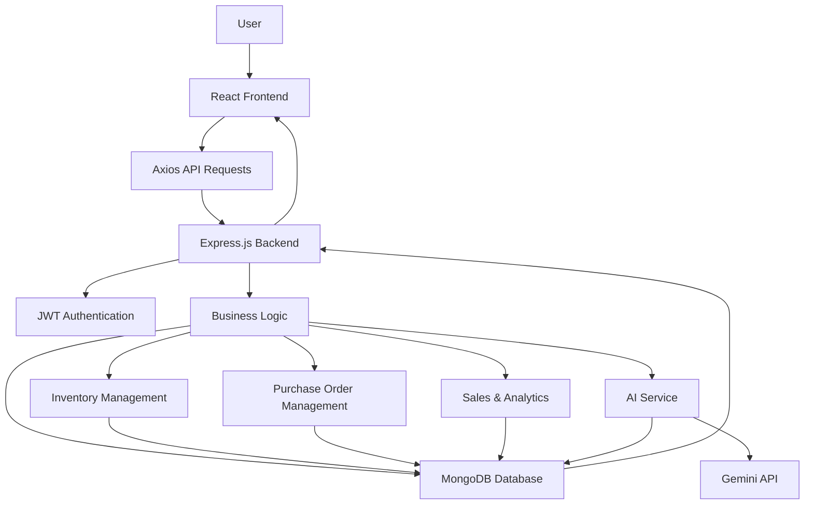
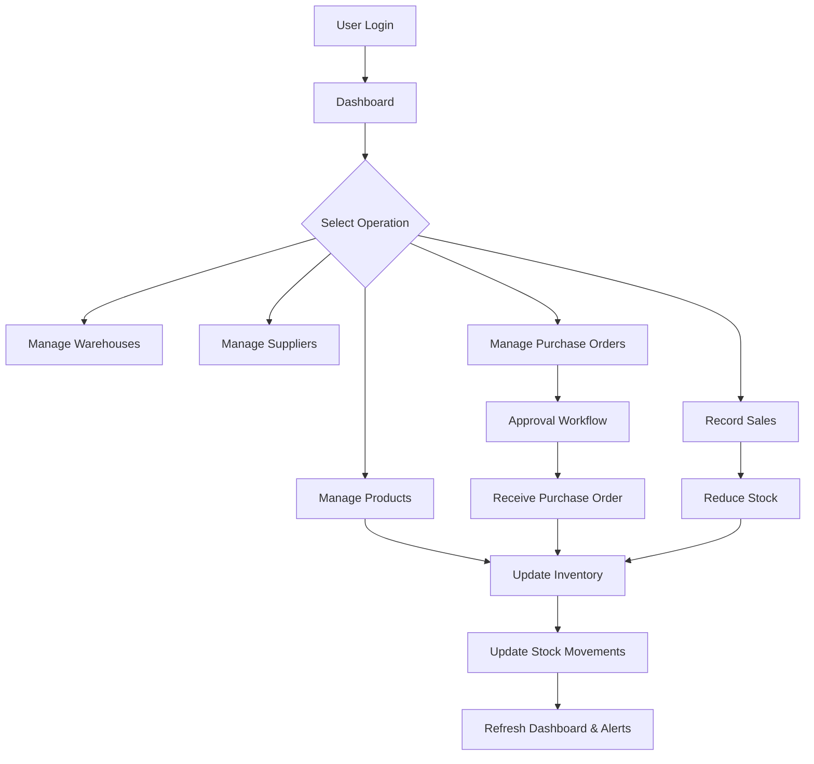
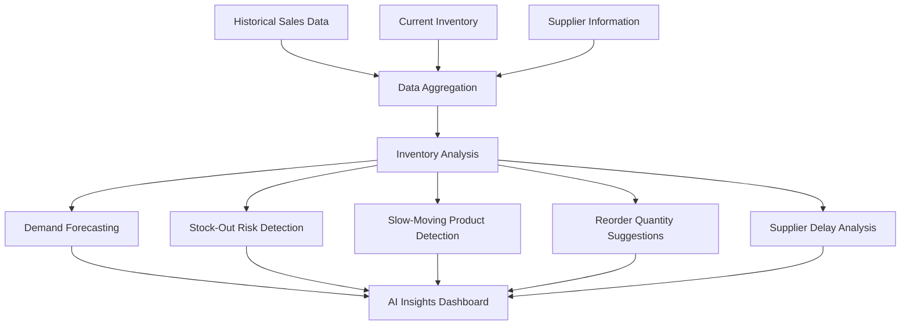

# SupplySense – AI-Powered Inventory & Supply Chain Management 🚀

<p align="center">
  <strong>Smarter Inventory. Better Forecasting. Efficient Supply Chains.</strong>
</p>

<p align="center">
  An AI-powered inventory and supply chain management platform that helps businesses monitor stock, manage warehouses, track suppliers, automate procurement workflows, and make smarter inventory decisions.
</p>

<p align="center">
  
  
  
  
  
  
</p>

---

## 🌐 Live Demo

🚀 **Live Application:** [Open SupplySense](https://supplysense-ai3785.ai.studio)

💻 **GitHub Repository:** [View Source Code](https://github.com/ujjwalawasthi7597-del/supplysense-ai-inventory-management)

## 📌 Overview

SupplySense is a full-stack inventory and supply chain management application designed to simplify inventory operations and improve business decision-making.

Businesses often struggle with stock shortages, excess inventory, delayed supplier deliveries, and inefficient procurement processes.

SupplySense addresses these challenges through a centralized dashboard that provides real-time inventory visibility, purchase order management, supplier tracking, sales analytics, and AI-assisted inventory insights.

The platform uses historical sales data and inventory information to generate demand forecasts, identify potential stock-out risks, and suggest optimal reorder quantities.

## 🎯 Problem Statement

Traditional inventory management systems often face challenges such as:

- Unexpected stock-outs and overstocking.
- Difficulty tracking inventory across multiple warehouses.
- Manual purchase order and supplier management.
- Limited visibility into sales and stock movement.
- Delayed identification of slow-moving products.
- Lack of data-driven inventory planning.

## 💡 Our Solution

SupplySense provides a centralized platform where businesses can:

- Monitor inventory levels and stock movements.
- Manage multiple warehouses and suppliers.
- Create and approve purchase orders.
- Track sales and procurement activities.
- Analyze inventory performance through dashboards.
- Use AI-assisted insights for smarter inventory decisions.

---

## ✨ Key Features

### 1. 📊 Interactive Dashboard
- Total products and inventory valuation.
- Warehouse and supplier overview.
- Low-stock and out-of-stock alerts.
- Pending purchase orders.
- Sales analytics and inventory movement charts.
- Top-performing products.

### 2. 📦 Product & Inventory Management
- Add, update, view, and delete products.
- Manage SKU, category, price, and stock quantity.
- Configure minimum stock thresholds.
- Track stock-in, stock-out, and adjustments.
- Maintain detailed inventory movement history.
- Prevent invalid stock operations and negative inventory.

### 3. 🏭 Warehouse Management
- Create and manage multiple warehouses.
- View warehouse-wise inventory.
- Track stock availability across locations.
- Support inventory transfer workflows.

### 4. 🤝 Supplier Management
- Maintain supplier profiles and contact details.
- Associate products with suppliers.
- Track supplier-related procurement activities.
- Analyze supplier delivery performance.

### 5. 🛒 Purchase Order Management
- Create and manage purchase orders.
- Track order status and received quantities.
- Support procurement approval workflows.
- Admin approval and staff purchase requests.
- Update inventory when orders are received.
- Maintain purchase order history.

### 6. 📈 Sales & Analytics
- Record sales transactions.
- Automatically update inventory after sales.
- Track product-wise sales performance.
- Analyze historical sales data.
- Monitor stock movement trends.

### 7. 🤖 AI-Powered Inventory Intelligence

SupplySense includes AI-assisted features to support better inventory decisions:

| AI Feature | Description |
|---|---|
| Demand Forecasting | Estimates future product demand using historical sales data. |
| Stock-Out Risk Detection | Identifies products that may run out of stock. |
| Smart Reorder Suggestions | Recommends reorder quantities based on stock and demand. |
| Slow-Moving Inventory | Identifies products with low sales activity. |
| Supplier Delay Analysis | Helps analyze supplier delivery patterns and delays. |

The forecasting and inventory calculations use available business data. AI-generated assistance can provide additional insights where configured.

### 8. 🔔 Notifications & Alerts
- Low-stock notifications.
- Out-of-stock alerts.
- Purchase order status updates.
- Inventory-related notifications.

### 9. 🔐 Authentication & Authorization
- Secure user authentication using JWT.
- Password hashing with bcrypt.
- Role-based access control.
- Admin and Staff roles.
- Protected API routes.

---

## 🛠️ Tech Stack

| Technology | Purpose |
|---|---|
| React.js | Frontend development |
| Vite | Frontend build tool |
| Tailwind CSS | UI styling |
| React Router | Client-side navigation |
| Axios | API communication |
| Recharts | Data visualization |
| Node.js | Backend runtime |
| Express.js | REST API development |
| MongoDB | NoSQL database |
| Mongoose | Database modeling |
| JWT | Authentication |
| bcrypt | Password hashing |
| Gemini API | AI-powered assistance |
| Git & GitHub | Version control |

---

## 🏗️ System Architecture

SupplySense follows a client-server architecture.



## 🔄 Inventory Management Workflow



## 🧠 AI Inventory Intelligence Workflow



---

## 🗄️ Database Design

SupplySense uses MongoDB with Mongoose schemas to manage application data.

| Collection | Purpose |
|---|---|
| Users | Stores user accounts, credentials, and roles. |
| Products | Stores product details and stock information. |
| Warehouses | Stores warehouse information. |
| Suppliers | Stores supplier details. |
| StockMovements | Tracks stock-in, stock-out, and adjustments. |
| PurchaseOrders | Stores procurement orders and approval status. |
| Sales | Maintains sales transaction records. |
| Notifications | Stores inventory alerts and system notifications. |

### Important Relationships

- Products are associated with warehouses and suppliers.
- Stock movements reference the relevant products and warehouses.
- Purchase orders contain product and quantity information.
- Sales transactions reference sold products.
- Users are associated with their assigned roles and activities.

---

## 🔌 API Structure

The backend exposes RESTful APIs for different application modules.

| Module | Example Endpoints | Purpose |
|---|---|---|
| Authentication | `/api/auth` | Registration and login |
| Products | `/api/products` | Product CRUD |
| Warehouses | `/api/warehouses` | Warehouse management |
| Suppliers | `/api/suppliers` | Supplier management |
| Inventory | `/api/inventory` | Stock operations |
| Purchase Orders | `/api/purchase-orders` | Procurement workflows |
| Sales | `/api/sales` | Sales transactions |
| Dashboard | `/api/dashboard` | Dashboard analytics |
| AI | `/api/ai` | Inventory intelligence |
| Notifications | `/api/notifications` | Alerts and notifications |

*These are API route prefixes; exact methods and endpoint paths depend on the implemented backend.*

---

## 📸 Screenshots

Add actual screenshots of your running application in the `docs/screenshots/` directory.

### Dashboard


### Inventory Management


### Warehouse Management


### Supplier Management


### Purchase Orders


### AI Inventory Insights


### Sales Analytics


---

## ⚙️ Getting Started

Follow these instructions to run SupplySense locally.

### Prerequisites

Make sure you have installed:

- Node.js (LTS version)
- npm
- MongoDB Atlas account or local MongoDB
- Git

### 1. Clone the Repository

```bash
git clone https://github.com/ujjwalawasthi7597-del/supplysense-ai-inventory-management.git
```

### 2. Navigate to the Project

```bash
cd supplysense-ai-inventory-management
```

### 3. Install Dependencies

Install frontend dependencies:

```bash
npm install
```

If your project contains a separate backend folder:

```bash
cd server
npm install
```

### 4. Configure Environment Variables

Create a `.env` file in the backend directory.

```env
PORT=5000
MONGODB_URI=your_mongodb_connection_string
JWT_SECRET=your_secure_random_secret
GEMINI_API_KEY=your_gemini_api_key
CLIENT_URL=http://localhost:5173
```

For the frontend, configure the backend URL if required:

```env
VITE_API_URL=http://localhost:5000
```

**Important:** Never upload `.env` files, database credentials, JWT secrets, or API keys to GitHub. Add them to `.gitignore`.

### 5. Run the Application

Start the backend:

```bash
cd server
npm run dev
```

Start the frontend in another terminal:

```bash
npm run dev
```

Open the local development URL displayed by Vite, usually:

```text
http://localhost:5173
```

*Note: Adjust the folder names and scripts according to the actual repository structure.*

---

## 🔒 Security & Best Practices

- JWT-based authentication.
- Password hashing using bcrypt.
- Role-based API authorization.
- Protected backend routes.
- Environment-based configuration.
- Input validation for inventory operations.
- Prevention of negative stock quantities.
- Server-side validation for purchase order and sales operations.

---

## 🚀 Future Enhancements

- Advanced demand forecasting with machine learning.
- Barcode and QR code-based inventory scanning.
- Automated purchase order generation.
- Real-time stock synchronization.
- Email and SMS notifications.
- Supplier performance scoring.
- Multi-branch business analytics.
- Advanced inventory optimization.

---

## 👨‍💻 Author

**Ujjwal Awasthi**

B.Tech – Computer Science & Engineering

- GitHub: https://github.com/ujjwalawasthi7597-del
- LinkedIn: https://www.linkedin.com/in/ujjwal-awasthi-90942237b
- LeetCode: https://leetcode.com/u/Ujjwal9795/
- GeeksforGeeks: https://www.geeksforgeeks.org/profile/ujjwalawavs96/

---

## ⭐ Support

If you find this project interesting, consider giving it a star ⭐ on GitHub.

**SupplySense – Turning Inventory Data into Smarter Business Decisions.**
